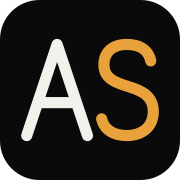

<div align="center">
  
  <h1>Abdelrahman Samy Ali — Portfolio</h1>
  <p><b>Software Engineer · Full-Stack & Mobile Product Engineering</b><br/>TypeScript · React · Node.js · PostgreSQL · Flutter</p>

  <p>
    <a href="https://abdelrahman-samy-portfolio.vercel.app/" target="_blank">
      
    </a>
    <a href="https://abdelrahman-samy-portfolio.vercel.app/ar" target="_blank">
      
    </a>
    <a href="https://abdelrahman-samy-portfolio.vercel.app/cv/Abdelrahman-Samy-Ali-CV.pdf" target="_blank">
      
    </a>
    <a href="https://www.linkedin.com/in/abdelrahman-samy-ali/" target="_blank">
      
    </a>
  </p>
</div>

## About

My personal site: who I am, what I've built, and how I work. I'm a Software Engineer at **Yamama Software**, working across the web app, API and Flutter mobile app of **[GlooFloo](https://gloofloo.com)** (AI-powered planning and project management) and on **[Rawaylo](https://rawaylo.com)** (an AI call center for restaurants). Both are live.

The site is bilingual — **English** at `/` and **Arabic** at `/ar`, with full right-to-left layout — and built to load fast on a phone.

---

## Tech Stack

<div align="center">
  
  
  
  
  
  
  
  
</div>

---

## Highlights

| Feature | Details |
|---|---|
| **Bilingual EN / AR** | Locale routes (`/`, `/ar`), `lang`/`dir` on `<html>`, RTL-aware layout, Lalezar + Alexandria for Arabic, `hreflang` alternates |
| **Cinematic hero** | 96-frame scroll-driven canvas sequence (48 on phones), streamed after the page loads |
| **Intro** | Drawn "AS" monogram and a curtain reveal, 0.8–1.6 s, over an already-rendered page; skipped with reduced motion |
| **Case studies** | One page per project (both languages): challenge, solution, architecture, decisions, lessons, and real product screens |
| **3D** | Lazy-loaded React Three Fiber orb (only downloaded when the contact section is near) + pointer-driven 3D tilt on project shots |
| **Design system** | All colors are tokens in `app/globals.css`; one `--accent-rgb` value re-themes the whole site |
| **SEO** | Per-locale metadata, generated Open Graph image, `sitemap.xml` with language alternates, `robots.txt`, JSON-LD `Person` |
| **Accessibility** | Respects `prefers-reduced-motion`, keyboard-operable experience rows and command palette (`Ctrl/⌘ + K`), focus styles |

### Performance work

| | Before | After |
|---|---|---|
| Hero frames (96) | 38 MB PNG, page blocked until all loaded | 1.3 MB WebP, streamed; page opens on the first frame |
| Project images | 9.8 MB JPEG/PNG at quality 100 | ≈ 0.5 MB WebP, served as AVIF/WebP by `next/image` |
| Unused code | three.js bundled with no 3D on the page | three.js only in a lazy chunk; dead hooks/animations removed |
| Smooth scroll | RAF loop never cancelled | cancelled on unmount; native scroll for reduced-motion users |
| Lighthouse (lab, Nov 2026) | mobile Perf 71, A11y 92 (`/ar`) | mobile Perf 85–94, desktop 99–100; A11y / Best practices / SEO 100 — see [docs/performance-report.md](docs/performance-report.md) |

---

## Project Structure

```
├── app/
│   ├── [lang]/                 # en | ar — root layout, home, case studies, OG image
│   │   ├── layout.tsx          # <html lang dir>, providers, metadata, JSON-LD
│   │   ├── page.tsx            # Home
│   │   └── work/[slug]/        # Case study pages
│   ├── globals.css             # Design tokens, Arabic/RTL rules, utilities
│   ├── icon.svg                # AS monogram favicon
│   ├── sitemap.ts · robots.ts
├── components/
│   ├── layout/                 # Navigation dock, LanguageSwitch, Footer, ScrollProgress, CustomCursor
│   ├── sections/               # Hero, About, Experience, Principles, SelectedWork, TechStack, Contact
│   ├── shared/                 # Preloader, Monogram, TiltCard, PhoneMockup, CommandPalette, …
│   └── three/                  # Lazy 3D orb (React Three Fiber)
├── constants/
│   ├── projects.ts             # Projects — shared data + English copy
│   ├── projects.ar.ts          # Arabic copy, keyed by slug
│   ├── experience.ts / .ar.ts  # Experience, same split
│   └── content.ts              # getProjects(locale) / getExperiences(locale)
├── lib/
│   ├── i18n.ts                 # locales, localePath()
│   ├── dictionaries.ts         # UI strings (EN / AR)
│   ├── fonts.ts · metadata.ts
├── providers/                  # LocaleProvider, Lenis, Animation
└── public/
    ├── images/hero/            # frame-001…096.webp
    ├── images/projects/        # WebP screenshots
    ├── cv/                     # Designed CV + ATS CV (PDF)
    └── resume.pdf              # Old CV URL, kept so existing links keep working
```

---

## Editing

- **Add a project:** add it to `constants/projects.ts`, its Arabic copy to `constants/projects.ar.ts` (same slug), and a WebP screenshot to `public/images/projects/`. Set `featured: true` to show it as a full case on the home page.
- **Change the accent color:** edit `--accent-rgb` in `app/globals.css`.
- **Update the CV:** edit `cv.data.json` in the CV source folder, rebuild, and copy both PDFs into `public/cv/` (and the designed one over `public/resume.pdf`).
- **Contact links:** `constants/profile.ts` is the only place they live.
- **UI text:** `lib/dictionaries.ts` (both languages side by side).

---

## Local Development

```bash
git clone https://github.com/abdelrahman-samy-dev/abdelrahman-samy-portfolio.git
cd abdelrahman-samy-portfolio
npm install
npm run dev        # http://localhost:3000  (Arabic: /ar)
npm run build      # production build
npm run test:e2e   # build + Playwright checks (EN/AR, desktop + phone)
```

Audit, design notes, performance and QA reports are in [`docs/`](docs/).

English is served at the root through a rewrite to `/en` (see `next.config.ts`); `/en/*` redirects back to the root so each page has one URL.

---

## Contact

- **Email:** abdelrahman.samy.dev@outlook.com
- **LinkedIn:** [abdelrahman-samy-ali](https://www.linkedin.com/in/abdelrahman-samy-ali/)
- **GitHub:** [@abdelrahman-samy-dev](https://github.com/abdelrahman-samy-dev)

<div align="center">
  <sub>Built with Next.js 16 & TypeScript by Abdelrahman Samy Ali.</sub>
</div>
